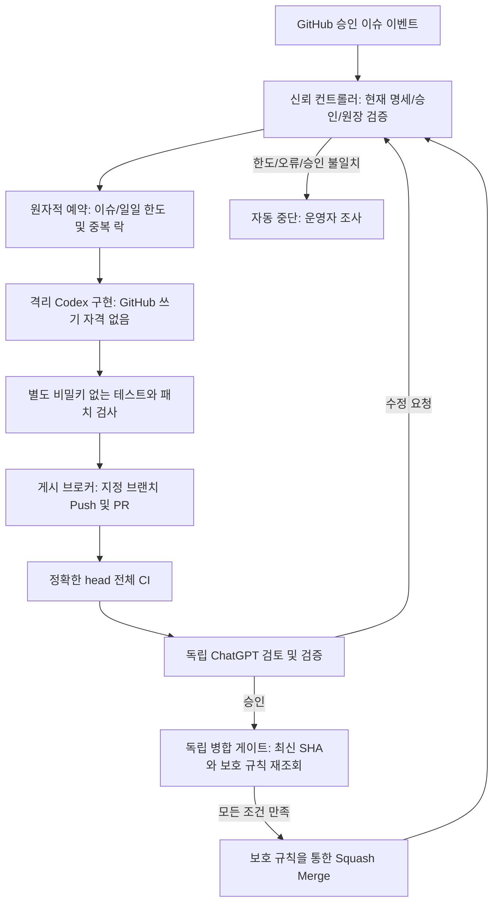

# 자동 개발·독립 검토·병합 아키텍처 제안

## 현재 구현 범위와 활성 상태

현재는 **P1 Fake-only 영속 원장과 P2 인증된 GitHub 읽기 전용 관측** 단계입니다. P2 권한·검증·관측 DB 및 제한은 [P2 문서](P2_GITHUB_READONLY.md)를 참고하세요. 로컬 트랜잭션·복구·모의 E2E는 [P1 원장 문서](P1_LEDGER.md)에 정리했습니다. 승인 이슈에서 실제 Codex 실행, 수정 Push, 독립 ChatGPT 호출, 병합까지 이어지는 운영 루프는 아직 연결하지 않았습니다. 키 등록·GitHub App 설치·권한 확대·브랜치 보호 변경·자동 병합 활성화는 수행하지 않습니다. 현재 모델 호출 수와 API 사용 비용은 0입니다. GitHub Actions 실행 시간 비용은 계정 정책에 따릅니다.

| 구성 | 이번 PR | 운영 활성화에 추가로 필요한 것 |
|---|---|---|
| GitHub 이벤트 | 기본 브랜치 코드와 GET REST 재조회; 메타데이터만 기록 | 서명 receiver·영속 공유 원장·누락 복구 |
| 승인·수정·병합 정책 | 순수 정책 및 ID/hash/head/run-job-Check 검증 | threads/rulesets·최종 atomic gate 검증 |
| 중복/재시도/예산 | SQLite 트랜잭션·영속 이벤트/예약·lease·복원 격리 및 Fake E2E | 다중 호스트의 단일 내구 원장·실제 사용량 집계·운영 복구 |
| Codex Action | 검증한 커밋 SHA의 비활성 템플릿, 마지막 단계·drop-sudo·workspace 프로필 | 별도 승인한 CLI 버전·격리 작업자·자격·예산 집행 |
| 독립 ChatGPT | 역할/메시지/검증 계약 | 별도 계정/연결·독립 리뷰 작업 및 GitHub 리뷰 발행 |
| Push/PR/병합 | 호출 코드/쓰기 권한 없음 | 독립 게시 브로커·보호 브랜치·병합 게이트 |

`.github/workflows/automation-observer.yml`은 이슈·댓글·PR 리뷰·커밋 갱신·CI 완료 이벤트를 관찰합니다. `master`만 checkout하고 PR head 코드를 실행하지 않습니다. P2는 인증된 현재 상태를 수집하지만 관측 전용이며 승인된 큐를 착수시키지 않습니다. 보호 규칙 조회 권한 부족이나 미검증 항목은 보류합니다. `policy.json.enabled=false`, builder/reviewer ID 빈 목록입니다. 이를 true로 바꿔도 관찰기가 작업자로 바뀌지는 않습니다. 비활성 작업자 예제는 workflows 밖의 `.github/automation/codex-worker.yml.example`에 있으며 `if: false`도 설정했습니다.

## 제안하는 완전 자동 사이클

구현자, 리뷰어, 병합자의 자격과 실행 환경은 공유하지 않습니다. Codex는 코드/테스트/PR만, ChatGPT는 설계/독립 검토/검증/병합 판단을 담당합니다. 별도 ChatGPT가 승인한 뒤에도 결정적 CI/보호 규칙을 우회할 수 없습니다. 현재 사람이 하던 전달은 향후 인증된 GitHub 이벤트와 브로커가 대신합니다. **승인 이슈 등록 자체는 사람이 수행하는 의도적 경계**이며 모든 공개 이슈를 자동 착수하지 않습니다.

## 승인 및 입력 계약

승인 대상은 이 저장소의 열린 일반 이슈이며 `autodev:approved` 라벨과 허용된 관리자의 `/autodev approve <현재 본문 UTF-8 SHA-256>` 댓글이 모두 필요합니다. 초기 관리자 ID 45135977은 저장소 소유자의 확인된 ID입니다. 이슈 본문 편집은 기존 승인을 무효화합니다. 라벨만 붙이거나 제3자 댓글, 모델의 자체 승인으로는 착수할 수 없습니다. 허용 관리자 목록 변경도 정책 PR 리뷰 대상입니다.

차후 컨트롤러는 webhook 서명/설치 저장소 확인 후 GitHub API에서 이슈/댓글/PR/리뷰/체크/스레드/보호 규칙을 다시 읽어야 합니다. webhook payload, artifact, 모델 JSON을 검증된 사실로 믿지 않습니다. 모든 페이지를 조회하거나 개수 상한 초과 시 중단합니다. 활성 큐는 이슈 번호 순으로 한 건씩 예약하며 다른 활성 작업이 있으면 다음을 착수하지 않습니다. 수락 기준과 허용 경로가 명세에 없으면 차단합니다.

브랜치는 `autodev/issue-N`, 승인 명세 해시·이슈 번호·출발 master SHA를 PR에 결합합니다. 새 명세로 재승인해도 같은 이슈의 누적 한도는 초기화하지 않습니다. 허용 경로는 현재 tests/docs/backtesting/data_analyzer/utils이며, 전략·주문·인증·설정·의존성·워크플로·정책·AGENTS는 자동 수정 금지입니다. 이런 변경은 별도 수동 설계/리뷰 경로가 필요합니다. 경로 탐색·심볼릭 링크·서브모듈·바이너리·삭제·파일 권한 변경·20개 초과 파일·대규모 diff도 게시 브로커에서 차단해야 합니다(이번 경로 함수는 기본 문자열/개수 정책만 검사합니다).

리뷰는 별도 신뢰 ID의 현재 head SHA에 대한 GitHub 표준 리뷰만 수락합니다. 본문에 “승인”이라고 쓴 댓글은 승인으로 해석하지 않습니다. 같은 리뷰어의 최신 리뷰가 우선하고, 오래된 head·작성자 본인 승인·불명확한 리뷰·미해결 스레드가 있으면 병합하지 않습니다. 새 push마다 기존 승인 재사용 없이 독립 검토와 CI를 다시 요구합니다.

## 공식 기능 검토 및 독립 리뷰 연결

공식 [Codex GitHub Action](https://learn.chatgpt.com/docs/github-action)은 GitHub 이벤트에서 CLI 작업을 실행할 수 있습니다. 검토한 `openai/codex-action` v1의 커밋은 `bdf19a4a223ec2549a3e2274a0cf61556bc07675`입니다. 템플릿은 현재 action.yml에서 확인한 `permission-profile`, `codex-version`, `safety-strategy`, `openai-api-key` 입력을 사용합니다. CLI 버전은 임의로 최신 설치하지 않고 사용자 검토한 정확한 semver가 필요합니다. 실제 Action은 실행하지 않았습니다.

공식 [GitHub 통합](https://learn.chatgpt.com/docs/third-party/github)은 Codex 리뷰와 댓글 기반 수정 작업을 지원합니다. 이것을 별도의 ChatGPT 검증 통과로 간주하지 않습니다. [ChatGPT 이벤트 작업](https://learn.chatgpt.com/docs/automations)은 지원되는 플랜/웹·모바일/연결에서 GitHub PR 활동을 감지할 수 있습니다. 기존 대화가 자동으로 GitHub App이 되는 기능은 확인하지 못했습니다. 이 저장소 PR만으로 기존 대화의 컨텍스트·플랜·도구 권한을 이전할 수 없습니다.

독립 리뷰 연결은 다음 중 별도 검증 후 선택합니다.

1. **별도 ChatGPT 웹/팀 작업**: 저장소 연결과 PR 이벤트 트리거, 독립 서비스 계정, 리뷰 도구 권한 및 실제 GitHub 표준 리뷰 발행을 사용자 쪽에서 확인합니다. 이벤트 작업이 단순 댓글만 쓰거나 표준 승인을 발행하지 못하면 병합을 중단합니다. 별도 대화의 사전 설계는 버전 관리한 문서로 제공해야 합니다.
2. **별도 리뷰 서비스**: 독립 OpenAI 프로젝트/리뷰 전용 자격·프롬프트·실행 환경·GitHub App으로 head 고정 리뷰를 구현합니다. 이는 기존 ChatGPT 대화 자체가 아니라 별도 API 기반 검토자이므로 역할 변경에 대한 사용자의 선택이 필요합니다. 코드는 실행하지 않고 diff/문서만 읽는 검토와, 비밀 없는 독립 테스트 실행을 분리합니다.

어느 경로도 현재 연결하지 않았으며 임의 모델 호출·봇 호출 댓글·웹 이벤트 작업 생성은 수행하지 않았습니다. 주관적인 LLM 검토만으로 안전성을 증명할 수 없으므로 고정 테스트, 안전 검사, 보호 규칙과 별도 자격 검증을 함께 요구합니다.

## 권한과 비밀정보

| 구성 | 향후 최소 권한 | 비밀정보 |
|---|---|---|
| P2 관찰기 | contents/issues/PR/checks/actions:read; metadata implicit | Actions 자동 단기 github.token만; 새 Secret 없음 |
| 컨트롤러/원장 | metadata·contents·issues·PR·checks·actions 읽기; 원장 전용 CAS 저장소 쓰기 | 컨트롤러 전용 App 키 |
| Codex 작업자 | contents:read; 저장소 쓰기·리뷰·병합 권한 없음 | 격리 환경의 OPENAI_API_KEY만 공식 proxy에 전달 |
| 패치 게시 브로커 | contents:write, pull_requests:write; 지정 브랜치/승인 범위만 | 게시 전용 단기 App installation token |
| 독립 리뷰어 | contents/checks/actions 읽기, pull_requests:write | 리뷰 전용 App 키, API 경로 선택 시 별도 OpenAI 키 |
| 병합 게이트 | PR/checks/review 읽기 및 merge에 필요한 contents:write | 별도 병합 전용 App token; 보호 규칙 우회 권한 없음 |

위는 제안할 권한 목록이지 현재 부여한 권한이 아닙니다. 브랜치 보호 읽기에 administration:read가 요구되는 경우 사용자 검토 후 읽기 전용만 부여하거나 별도 관리자 검증 증빙을 사용합니다. 확인 불가 상태를 통과로 간주하지 않습니다.

API 키와 App private key는 **사용자가 GitHub Secrets/Environment Secrets에만 등록**합니다. 소스·문서·이슈·댓글·프롬프트·로그·artifact에 값을 넣지 않습니다. App ID/installation ID 같은 비밀 아닌 값은 Variables에 둘 수 있습니다. Upbit/Slack/맥북 SSH 자격은 어떤 작업에도 전달하지 않습니다. OpenAI 키의 정상 추론 인증 전달 외에는 키를 외부로 전송하지 않습니다.

비밀이 있는 작업에서 PR 코드/테스트/설치 스크립트를 실행하면 유출될 수 있습니다. 실제 빌더에는 GitHub 쓰기 키가 없어야 하고, 공식 Action의 제한된 proxy와 drop-sudo를 사용해야 합니다. dependency 설치와 테스트는 OpenAI 키를 주입하기 전 별도 환경 또는 자격 없는 별도 작업에서 실행합니다. PR의 config/AGENTS/MCP/hooks/워크플로 변경을 신뢰 설정으로 사용하지 않습니다. 비밀 없는 테스트도 일회성 GitHub-hosted 환경에서 네트워크를 제한하고 출력/시간/디스크 한도를 둡니다. self-hosted 맥북 runner는 사용하지 않습니다.

공식 Action 자체의 API 프록시 사용은 원격 요청량과 금액의 hard cap을 제공한다는 의미가 아닙니다. 모델의 shell 네트워크 차단과 추론 프록시 통신 허용은 별개이며, 프록시/패키지 공급망을 포함한 위협 검토가 필요합니다. 키 마스킹은 완전한 유출 방지책이 아닙니다.

## 중복·루프·반복 실패 및 비용

- 기본 제한은 **이슈당 총 3회**(최초 구현 1 + 수정 최대 2), **연속 실패 2회** 후 중단, 실행당 20분입니다. CI 실패/취소/시간 초과/모델 오류도 실패로 기록합니다. 자동으로 한도를 초기화하거나 무한 재시작하지 않습니다.
- 이슈/spec/head/review ID를 결합한 멱등 키와 이슈 단위 in-flight 락을 사용합니다. 동일 리뷰 이벤트/재전송은 재예약하지 않습니다. GitHub concurrency는 보조 장치이며 영속 원장이 아닙니다. 한도 소진은 새 구현/수정을 막지만 마지막 성공 결과에 대한 검토·병합 판단은 허용합니다.
- 원장은 저장소 코드 밖의 신뢰 저장소에서 원자적 CAS 또는 트랜잭션으로 예약해야 합니다. 실패·취소 후 예약 금액을 자동 환급하지 않고, 취소된 작업의 상태 불명확 시 잠금을 유지해 조사합니다. GitHub artifact/cache나 수정 가능한 댓글만을 돈/중복 원장의 단일 진실로 사용하지 않습니다. P1의 로컬 SQLite 어댑터는 구현했으나 실제 GitHub/유료 작업 연결과 다중 호스트 운영 원장은 아직 구현하지 않았습니다. 복원은 격리 상태이며 실제 비용/외부 결과 대조 없이 재개할 수 없습니다.
- 설정의 예약 상한은 회당 $5, 이슈당 $15, 일당 $50입니다. 이는 **테스트한 입장 제어 정책**일 뿐 실제 청구액 hard cap이 아닙니다. 액션 시간 제한도 금액 상한이 아닙니다. 실제 사용량 집계와 요청 전 최대 토큰/비용 예약을 집행하는 신뢰 프록시 또는 검증된 공급자 hard quota가 준비될 때까지 모델 작업자 활성화 금지입니다. 프로젝트 예산 알림만으로 hard cap을 주장하지 않습니다.
- [OpenAI API 가격](https://developers.openai.com/api/docs/pricing)은 토큰/모델/서비스 계층에 따라 다르며 ChatGPT 사용권과 별도 확인해야 합니다. 계산은 `입력 토큰×입력 단가 + 출력(추론 포함) 토큰×출력 단가`이고 모든 agent 반복 호출을 합산해야 합니다. 2026-10-21 표준 gpt-6.1-sol의 표시 단가 $2/$10 per 1M을 예로 들면 누적 100k 입력+20k 출력은 약 $0.40입니다. 이는 예시이며 실제 모델 선택·캐시·서비스 계층·총 호출량에 따라 달라집니다. 템플릿은 모델이나 유료 실행을 선택하지 않습니다. 리뷰 서비스 비용과 GitHub runner/artifact 비용도 별도입니다.

## CI 및 병합 게이트 (아직 연결하지 않음)

최신 head의 Linux/macOS/Windows 전체 Python 3.12 테스트와 safety gate를 전부 **completed/success**로 요구합니다. skipped/neutral/pending/취소/실패는 허용하지 않습니다. 이름뿐 아니라 GitHub Actions App, 신뢰 CI workflow 경로·실행 ID·실제 테스트 SHA 및 변경 불가능한 기준 workflow를 검증해야 합니다. 테스트 출력의 OK 문자열만으로 통과하지 않습니다. 독립 리뷰어 역시 별도 환경에서 검증 기록을 남겨야 합니다.

사용자가 master에 필수 검사·최신 push 별도 승인·과거 승인 무효화·스레드 해결·최신 base·관리자/앱 우회 금지를 설정해야 합니다. [GitHub 보호 브랜치](https://docs.github.com/en/repositories/configuring-branches-and-merges-in-your-repository/managing-protected-branches/about-protected-branches)의 검사 출처 제한을 사용합니다. 이번 정책은 GitHub 기본 허용보다 엄격하게 skipped/neutral을 거부합니다. 자동 작업자는 보호 규칙과 워크플로를 수정할 수 없어야 합니다.

병합 직전 GitHub에서 head/spec/base/CI/리뷰/스레드/정책을 재조회하고 예상 head SHA를 전달하는 merge API를 사용해야 합니다. head가 움직이거나 보호 규칙을 확인할 수 없으면 중단합니다. admin bypass/강제 push/직접 master push/리뷰 dismiss는 금지합니다. LLM 출력은 명령이 아니며 마지막 게이트가 기계적으로 승인해야 합니다. 본 PR에는 merge API 호출 자체가 없습니다.

[GITHUB_TOKEN 이벤트 규칙](https://docs.github.com/en/actions/concepts/security/github_token) 때문에 token으로 push한 뒤 다음 CI가 무인 실행된다고 가정하면 안 됩니다. 현재 문서상 일부 PR 이벤트는 승인 필요 상태로 만들어질 수 있습니다. 향후 게시 전용 App token 또는 검증된 명시적 dispatch 설계로 연결하고, CI가 없으면 기다리며 절대 통과로 간주하지 않습니다. App 설치·권한 확대는 이번 PR에서 수행하지 않습니다.

## 정확히 사용자 설정이 필요한 부분

1. 이 설계 PR을 독립 검토하고, 현재 사람 중심 병합 규칙을 언제/어디까지 바꿀지 결정합니다. 지금 규칙은 유지합니다.
2. 별도 ChatGPT 리뷰 연결 방식과 실제 계정/플랜/표준 GitHub 리뷰 쓰기 가능 여부를 확인합니다. builder와 reviewer의 서로 다른 불변 ID를 등록합니다.
3. 게시/검토/병합 App의 분리 설치와 최소 권한, 저장소 범위, short-lived token, 보호 브랜치 규칙을 사용자 계정에서 설정합니다.
4. OpenAI 전용 프로젝트/서비스 계정/요금·모델·CLI 버전·quota를 승인하고 키를 Secrets에 직접 등록합니다. 예: OPENAI_API_KEY, 필요 시 OPENAI_REVIEW_API_KEY 및 분리 App private key. 값을 이슈나 대화에 붙이지 않습니다.
5. P1 SQLite/Fake-only 원장을 실제 내구 서비스로 운영하는 경계와 패치 브로커·실제 비용 집행·인증된 상태 수집·리뷰 연결·최종 병합 게이트를 별도 PR로 구현/검증합니다. 이것들은 단순 사용자 스위치가 아니라 **남은 구현 작업**입니다.
6. 비밀 없는 dry-run → 허용된 작은 문서/테스트 이슈의 제한된 빌드 → 자동 수정 → 독립 리뷰 검증 순으로 단계별 E2E를 수행한 뒤 마지막에만 실제 개발/병합 자동화를 활성화합니다.

최소한 동시 webhook, 재전송, 수정 중 head 이동, 승인 이후 push, 비용 초과, 반복 CI 실패, 리뷰어 장애, 보호 규칙 변경, 악성 이슈/PR·dependency의 프롬프트 주입과 유출 시도를 E2E로 검증해야 합니다. 이 PR의 단위 테스트는 그런 외부 시스템/자격·청구/병합 E2E를 대신하지 않습니다.

## 절대 금지 유지

실제 업비트 매수/매도, 실거래 모드, 맥북 운영 자동 배포, 검증되지 않은 전략의 운영 채택, 인증정보 출력/유출, 검증 우회 병합은 자동 개발 승인 범위에 포함되지 않습니다. 자동화를 활성화하더라도 이 금지는 정책/권한/격리 경계에 남아 있어야 합니다. 이 자동화 PR은 직접 병합하지 않고 별도 ChatGPT 리뷰를 기다립니다. PR #8의 연구 변경은 최신 master에서 그대로 보존합니다.
