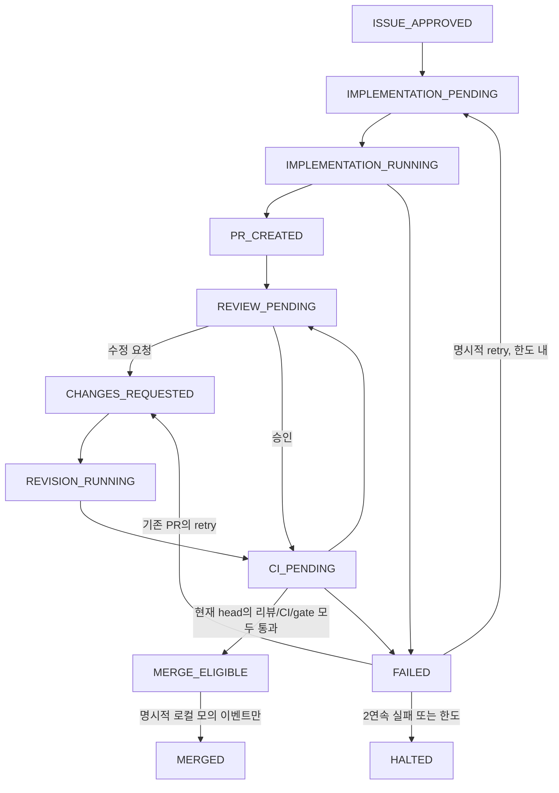

# P1: SQLite 영속 원장과 Fake-only 개발 오케스트레이터

## 활성화 상태와 신뢰 경계

이 구현은 **로컬 Dry-run 기반**입니다. GitHub/Codex/Reviewer는 정확한 Fake 타입만 허용하고 HTTP·모델·Git·Push·실제 PR 생성·실제 병합·운영 봇 실행 코드를 갖지 않습니다. CLI에 live 모드나 API 키 인자가 없습니다. `.github/automation/policy.json`의 `enabled=false`, 빈 builder/reviewer ID, 비활성 worker 예제, `REAL_TRADING=False`를 유지합니다. 기존 읽기 전용 observer를 유료 작업자나 영속 서비스로 연결하지 않습니다.

이 PR 자체의 개발 브랜치/Push/PR/CI는 개발 규칙에 따른 결과 전달입니다. 모의 오케스트레이터의 Fake GitHub 동작과는 별개이며, 모의 E2E는 외부 서비스를 호출하지 않습니다. `MERGED` 역시 로컬 DB 상태 이름일 뿐 GitHub 병합이 아닙니다. 기본 데모는 `MERGE_ELIGIBLE`에서 멈춥니다.

실제 승인·리뷰·CI·보호 규칙의 진위는 아직 인증하지 않습니다. Fake fixture의 메타데이터가 검증 경계를 대신합니다. 실제 GitHub 이벤트를 이 원장에 바로 공급해서는 안 됩니다. 기존 ChatGPT 대화/App/Secrets도 연결하지 않습니다.

## 저장 방식 선택과 트랜잭션

표준 라이브러리 `sqlite3`를 선택했습니다. 로컬 단일 파일을 공유하는 여러 프로세스가 트랜잭션으로 경합할 수 있고 별도 서버/패키지가 필요하지 않아 P1 재현에 적합합니다. 단일 writer인 점과 로컬 파일 잠금에 의존한다는 점을 제약으로 받아들입니다. **네트워크 파일시스템/NFS/SMB나 서로 다른 GitHub-hosted runner의 별도 DB를 공유 원장으로 취급하지 않습니다.** 실제 Actions 간 영속 서비스는 별도 운영 설계가 필요합니다.

- 명시적 `create()`만 새 DB를 만듭니다. 열기 실패·DB 삭제·손상 시 자동으로 빈 원장을 만들지 않습니다. 초기화 중 중단된 파일도 남겨 조사합니다.
- SQLite WAL, `synchronous=FULL`, foreign keys, `trusted_schema=OFF`, 5초 lock timeout을 사용합니다. 모든 읽기-검사-변경은 `BEGIN IMMEDIATE`에 묶습니다. 시간 초과/잠금/SQL 오류는 실행 차단이며 무한 재시도하지 않습니다.
- 예약, 일일/이슈별 합계, 작업 시도, projection, 이벤트, 전이 journal은 한 커밋으로 저장합니다. 예외·프로세스 중단 전 미커밋 변경은 롤백됩니다. 외부 side effect에 대한 exactly-once 보장은 아닙니다.
- DB 파일은 신규 생성 시 POSIX mode 0600을 요청합니다. Windows는 상속 ACL도 운영자가 확인해야 합니다. DB는 암호화하지 않으며 개인 원문은 저장하지 않지만 업무 메타데이터의 파일 접근 제어가 필요합니다.

| 테이블 | 역할 |
|---|---|
| meta | fake-only 모드, schema/policy hash, UTC clock watermark, 복원 격리 상태 |
| issues | 현재 상태·projection 버전·승인 hash/버전·횟수·예약·PR/head·리뷰·CI·gate 증빙 |
| approvals | 승인 원문 SHA-256, 승인 버전, Fake 관리자 ID; 원문 미저장 |
| attempts | 작업 번호/fencing, 소유 worker UUID, 시작/만료, UTC 예약일, 금액, dispatch 여부, 결과 |
| budgets | 모든 이슈에 걸친 UTC 일별 누적 예약 센트 |
| events | delivery UUID와 의미 fingerprint의 UNIQUE 제약, 처리 결과·고정 사유·시각 |
| transitions | 상태 전이·projection 버전·시각·최종 projection hash; FK로 이벤트와 연결 |

이벤트 원문·이슈 본문·리뷰 본문·토큰·프롬프트·모델 출력은 테이블이나 로그에 보관하지 않습니다. Event dataclass는 허용된 메타데이터만 받습니다. 승인 본문은 Fake 메모리에서 hash/승인 계약을 확인한 뒤 버립니다. CLI 출력은 상태/횟수/금액 요약과 고정 사유뿐이며 잘못된 인자/예외의 원문도 출력하지 않습니다. 백업도 Git에 넣지 않습니다.

## 중복·버전·동시성

delivery UUID 재전송과 같은 의미의 메타데이터 fingerprint 재전송은 `DUPLICATE`로 반환하고 새 예약/전이를 만들지 않습니다. 같은 delivery ID에 다른 내용을 붙이면 차단합니다. DB에 저장한 거부/오래된 이벤트도 멱등적으로 처리합니다. 원문이 없는 fingerprint는 메시지 인증이나 비밀 서명이 아닙니다.

claim은 현재 projection 버전과 worker UUID가 맞아야 합니다. 트랜잭션과 issue별 단일 RUNNING 시도 인덱스가 동시에 하나의 claim만 허용합니다. dispatch는 별도의 영속 0→1 marker로 한 번만 승인합니다. 동일 worker의 중복 호출도 두 번 실행하지 않습니다. 작업 번호가 fencing token이고, 완료/heartbeat는 소유자·시도 번호·유효 lease를 재확인합니다. 승인 변경으로 중단된 작업의 늦은 완료는 수락하지 않습니다.

별도의 승인 버전, 작업 번호, head 버전, projection 버전을 둡니다. 승인 버전은 명세 이력, 작업 번호는 총 실행 한도, head 버전은 리뷰·CI 대상, projection 버전은 원자적 변경 순서를 뜻합니다. 승인 본문 수정/승인 취소는 HALTED입니다. 새 명세가 다시 승인되면 새 승인 버전/hash는 기록하지만 기존 지출/시도를 초기화하거나 자동 재개하지 않습니다.

## 상태 전이



표현을 간소화한 도식이며 코드의 GRAPH와 각 이벤트 전제 조건을 함께 적용합니다. heartbeat/dispatch/gate 등 메타데이터 갱신은 같은 상태에서도 journal 버전을 증가시킵니다. 불가능한 전이는 `REJECTED`, 이전 spec/head/review/CI 이벤트는 `STALE`로 기록하며 상태를 승격하지 않습니다. `HALTED`/`MERGED`는 실행에 대해 terminal입니다.

- review/CI 도착 순서가 바뀌어도 **현재 head의 독립 승인 + 전체 CI success + 검증 gate**를 모두 기다립니다. Fake reviewer는 builder와 별도 ID입니다. 기존 `policy.plan()` 계약을 Fake 증빙으로 재사용합니다. 명세 본문을 저장하지 않기 위해 gate의 승인 placeholder는 합성 값이며, 실제 명세의 승인/hash/version 일치는 저장소가 별도로 강제합니다. 이것은 실제 승인 인증이 아닙니다.
- 새 head 이벤트는 head 버전이 정확히 다음이어야 합니다. 과거 승인/CI/checks/gate를 모두 지워 재검증합니다. 이전 head 리뷰나 CI는 새 head에 적용할 수 없습니다.
- CI는 Linux/macOS/Windows 및 safety gate의 정확한 이름/현재 SHA/신뢰 App·workflow/completed/success가 모두 있어야 합니다. skipped/neutral/누락/중복/가짜 출처는 통과시키지 않습니다.
- CI 실패는 FAILED 또는 연속 실패 한도에서 HALTED입니다. 늦은 CI 통과나 리뷰, retry 의사 표시만으로 실패를 지우거나 수정을 건너뛰지 않습니다. 명시적 retry→claim→새 작업이 필요합니다. 재작업 완료만으로 실패 횟수를 지우지 않고, 전체 검증의 병합 가능 판정에서만 0으로 돌아갑니다.
- PR 번호는 첫 Fake 게시 때 고정하고 revision에서 바꾸지 않습니다. `MERGE_ELIGIBLE` 이후 새 commit/gate/리뷰/CI가 바뀌면 자격을 잃습니다. 모의 MERGED 전에도 조건을 다시 검사합니다.

## lease와 중단·재조정

lease는 1~300초, 한 작업의 절대 실행 시간은 최대 1,200초입니다. 갱신은 현재 projection 버전·동일 소유자·미만료 lease를 요구하며 절대 시간을 연장하지 못합니다. heartbeat는 새 시도/비용을 만들지 않습니다.

| 상황 | 처리 |
|---|---|
| 커밋 전 프로세스 종료 | SQLite 롤백; 부분 예약/이벤트/시도 없음 |
| 예약 후 dispatch 전 재시작 | 원래 소유자 외 claim/완료 금지; 자동 실행 재개 없음 |
| dispatch 후 결과 기록 전 중단/예외 | 결과 모호. 기록 가능하면 UNKNOWN/HALTED, DB 불가면 RUNNING fence를 보존하고 만료 조정 |
| lease 만료 | `reconcile()`가 UNKNOWN + HALTED를 원자적으로 기록. 자동 소유권 강탈/재시도/환급 없음 |
| PR/리뷰/CI 대기 중 재시작 | 저장된 head/승인/CI/예약으로 계속 모의 판단 가능; 다시 Codex를 실행하지 않음 |
| 시스템 UTC 역행 | watermark보다 이전 시간이면 실행 차단; 시간을 정상화하고 조사 |

오케스트레이터 시작 시 만료 lease를 조정합니다. 만료 전 다른 프로세스는 작업을 훔치지 못합니다. 만료를 “작업이 실행되지 않았다”는 증거로 삼지 않습니다. P1에는 HALTED를 무조건 풀어 주는 override/requeue/SQL 수정 도구가 없습니다. 실제 side effect/비용을 확인하고 재조정하는 운영자 프로토콜은 후속 검토 대상입니다.

## 모의 비용 정책

회당 500센트($5), 이슈당 1,500센트($15), 전체 UTC 일일 5,000센트($50), 총 작업 3회(최초1+재작업최대2), 2연속 실패 중단을 그대로 강제합니다. 센트는 bool/float가 아닌 정수입니다. 이 한도를 늘린 정책으로 새 P1 원장을 만드는 것도 거부합니다. 정책 hash가 달라지면 기존 원장을 열 수 없고, 검토된 명시적 migration이 필요합니다.

한 번 예약한 금액은 실패·취소·lease 만료·승인 변경으로 자동 환급하지 않습니다. UTC 날짜가 바뀌면 새 일일 합계가 생기지만 이전 날짜 및 이슈 합계는 남습니다. 다른 이슈가 동시에 예약해도 같은 DB 트랜잭션에서 합산합니다. SQLite DB를 여러 개 만들면 전역 한도가 공유되지 않으므로 **단일 신뢰 원장**이 필요합니다. 임의 DB 복제/삭제/수동 편집은 통제가 아닙니다.

이는 **실제 OpenAI 청구 hard cap이 아닌 모의 예약 한도**입니다. 토큰/추론/총 API 호출량/실제 청구액을 계측하거나 제한하지 않습니다. 따라서 유료 실행을 허용하는 코드·스위치가 없습니다. API 키와 GitHub Secrets를 사용하지 않습니다.

## 무결성·백업·복구

schema/application ID와 schema hash, 정책 hash, journal/projection 연쇄·checksum, 시도 순서/소유자/시간, foreign keys, 이슈 및 일일 예약 합계를 검사합니다. startup/명시적 integrity에서는 SQLite `integrity_check`도 실행합니다. 손상·누락·알 수 없는 schema·불일치·정책 변경은 fail-closed입니다. SQLite 파일을 악의적으로 소유한 공격자에 대한 서명/anti-rollback 시스템은 아닙니다.

```bash
# 각각 새 DB 경로를 사용합니다. 이미 있는 DB를 덮어쓰지 않습니다.
python -m automation demo --database runtime/p1-normal.sqlite3 --scenario normal
python -m automation demo --database runtime/p1-revision.sqlite3 --scenario revision
python -m automation demo --database runtime/p1-failure.sqlite3 --scenario failure
python -m automation status --database runtime/p1-normal.sqlite3
python -m automation reconcile --database runtime/p1-normal.sqlite3

# source는 닫거나 읽기 가능한 검증된 원장. destination은 새 파일이어야 합니다.
python -m automation backup --database runtime/p1-normal.sqlite3 --output runtime/p1-backup.sqlite3
python -m automation restore --backup runtime/p1-backup.sqlite3 --output runtime/p1-restored.sqlite3
python -m automation status --database runtime/p1-restored.sqlite3
python -m unittest discover -v
```

1. 먼저 실행을 중단/격리하고 `integrity()`를 확인합니다. 손상된 원장을 자동 재생성하거나 삭제하지 않습니다.
2. Python SQLite Online Backup API로 일관된 새 DB 스냅샷을 만듭니다. 활성 WAL DB의 본체 파일만 단순 복사하지 않습니다. 백업 무결성과 SHA-256 sidecar를 생성합니다. 백업·sidecar를 접근 제한된 별도 저장소에 함께 보관하고 보존/암호화/주기 정책을 정해야 합니다. P1은 자동 원격 백업 서비스를 만들지 않습니다.
3. 복원은 checksum/schema/policy/무결성 검증 후 **새 목적지에만** 합니다. 성공한 복원 DB에는 `recovery_required=1`을 기록해 모든 submit/reconcile을 금지합니다. 조회/무결성 점검만 가능합니다.
4. backup 이후 유실된 이벤트·작업·예약이 없다고 가정하지 않습니다. projection/journal/기존 lease/비용 합계를 유지한 채 외부 side effect와 비용/최신 high-water mark를 대조해야 합니다. P1에는 격리 해제 API가 없으므로 복원 즉시 자동 개발이 재개되지 않습니다.
5. 외부 대조와 승인된 migration/재조정 절차가 준비된 별도 PR에서만 해제를 검토합니다. 오래된 backup으로 원장을 바꿔 횟수·비용 한도를 초기화하지 않습니다. 완전한 디스크 롤백/악의적 조작 탐지는 외부 anchor 없이는 불가능합니다.

공식 근거: [Python 3.12 sqlite3](https://docs.python.org/3.12/library/sqlite3.html), [SQLite transactions](https://www.sqlite.org/lang_transaction.html), [Online Backup API](https://www.sqlite.org/backup.html). SQLite는 동시 writer 하나를 지원하므로 BEGIN IMMEDIATE로 예약 경쟁을 직렬화합니다. Backup API는 활성 DB의 스냅샷을 얻는 데 사용하며 실제 전원 상실/파일시스템 장애 검증을 대신하지 않습니다.

## 검증 범위와 실제 활성화 전 체크리스트

회귀 테스트는 기존 154개와 새 P1 테스트를 함께 실행합니다. Fake 정상/수정/실패 E2E, 소켓 연결 차단, 승인/버전/중복/순서 역전, lease/예외/재시작, 다중 스레드와 spawn 프로세스 경합, 일일 비용 경합, 자식의 실제 commit 전 `os._exit`, 트랜잭션 rollback, 손상·잠금·backup quarantine 등을 검증합니다. 데모의 고정 UTC fixture와 상태/카운터 출력은 재현 가능하며 UUID는 로컬 멱등/fencing용입니다.

- [ ] 실제 GitHub delivery 서명·App/저장소/actor·최신 명세 및 승인 증빙 검증 어댑터. 모든 페이지/최신 이벤트를 검증하고 입력 크기를 제한할 것
- [ ] 실제 배포 topology의 단일 내구 원장, 여러 호스트 저장소/락·장애 조치 및 anti-rollback anchor. GitHub artifact/cache를 authoritative DB로 쓰지 말 것
- [ ] 실제 모델 사용량·비용 계측과 요청 전 hard spend enforcement. 프로젝트 알림/예약값을 청구 hard cap으로 부르지 말 것
- [ ] 격리 작업자와 안전한 패치 브로커/별도 테스트 환경. 네트워크 egress·의존성·MCP/hooks·프롬프트 주입·credential 유출 검증
- [ ] 별도 ChatGPT/Reviewer 계정·서비스와 독립 GitHub identity 및 읽기/리뷰/게시/병합 권한 분리
- [ ] 보호 브랜치 필수 검사/최신 head 승인/스레드 해결/최신 base/우회 금지의 진위 확인 및 원자적 최종 merge gate
- [ ] UNKNOWN 작업/backup 복구의 실제 결과·비용 대조와 명시적 운영자 재조정 프로토콜
- [ ] 장애·취소·중복·순서 역전·중간 push·재해 복구·clock·최대 부하의 서비스 통합 E2E와 관측/경보/보존 정책
- [ ] 사용자의 별도 승인과 보안 검토. 키/App/권한/실거래/배포를 이번 PR로 승인받은 것으로 해석하지 말 것

기존 전략·주문·영속 주문 복구·실제 시장 연구 파일은 변경하지 않습니다. SQLite 표준 라이브러리 외 새 의존성은 추가하지 않습니다. 이 문서의 구현 완료는 운영 자동화 활성화를 뜻하지 않습니다.
