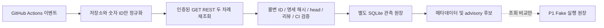

# P2: 인증된 GitHub 읽기 전용 관측

## 범위와 권한 경계

P1 실행 미연결 상태를 유지하면서 webhook을 사실이 아닌 **재조회 힌트**로 취급하는 REST 수집기를 추가합니다. Issue 본문/댓글은 메모리에서만 해시/정확한 승인 구문을 검사합니다. P2 결과는 관측 후보이며 실행 허가가 아닙니다. `enabled=false`, 빈 builder/reviewer ID 목록, `REAL_TRADING=False`, P1 Fake-only 타입 제약과 예약 정책은 변경하지 않습니다.

`automation/github_read.py`는 GET transport, `github_verify.py`는 닫힌 Snapshot 검증, `github_observe.py`는 이벤트 정규화/별도 DB, `tools/automation_plan.py`는 master entry point입니다. 실행/쓰기 API, 모델 SDK, subprocess 실행은 이 경로에 없습니다. 테스트만 별도 자식 Python을 중단하여 복구를 검증합니다.

## 인증 및 최소 읽기 권한

| 정보 | 필요한 저장소 권한 | 현재 연결 상태 |
|---|---|---|
| Repository/default branch, branch SHA | Metadata(implicit), Contents read | Actions 자동 단기 `github.token` |
| Issue/labels/comments | Issues read | 동일 |
| PR/files/reviews | Pull requests read | 동일 |
| Check runs | Checks read | 동일 |
| Workflow runs/attempt jobs/workflow | Actions read | 동일 |
| Classic protection/review requirements | Administration read | **일반 GITHUB_TOKEN으로 설정 불가; 미확인 시 PENDING** |
| Active rulesets | Metadata read/API 가용성 | 비어 있지 않으면 미해석 상태로 PENDING |

P2는 Secrets를 새로 등록/조회하지 않습니다. `github.token`은 Actions 자동 임시 자격이며 읽기 권한만 명시합니다. `metadata: read`는 Actions permissions 키가 아니므로 적지 않습니다. 토큰/headers/exception/원문을 출력하지 않습니다. 사용자 토큰의 실제 grant 전체가 읽기 전용임을 코드가 증명하지는 않지만 transport는 닫힌 GET endpoint만 제공합니다.

Repository 이름과 불변 ID `888367411`을 고정하고 default branch가 정책의 `master`와 일치해야 합니다. 토큰은 메모리에서 Authorization header로 `https://api.github.com`에만 보냅니다. redirect, 환경 proxy, remote Link URL을 사용하지 않습니다. 인증 없이는 익명 fallback하지 않습니다. 요청당 10초/응답 2MB/총 120회/collection 10페이지(100개씩)의 상한, 전체 페이지·total_count·중복 ID를 검사합니다. 자동 retry 루프는 없습니다. 401/403/404/429/5xx/네트워크·JSON 오류/필드 누락/잔여 rate limit 0은 보류합니다.

근거: [보호 브랜치 REST/권한](https://docs.github.com/en/rest/branches/branch-protection?apiVersion=2022-11-28), [Check runs](https://docs.github.com/en/rest/checks/runs?apiVersion=2022-11-28), [workflow jobs](https://docs.github.com/en/rest/actions/workflow-jobs?apiVersion=2022-11-28), [GITHUB_TOKEN](https://docs.github.com/en/actions/tutorials/authenticate-with-github_token).

## 승인 및 PR 신뢰 검증

열린 일반 Issue + 정확한 `autodev:approved` 라벨 + 관리자 ID의 실제 User가 작성한 `/autodev approve <현재 body UTF-8 SHA-256>` 댓글이 모두 필요합니다. login/표시 이름/author_association은 권한 증거가 아닙니다. 댓글은 해당 Issue API URL 소속이어야 하며 편집된 댓글은 인정하지 않습니다.

Issue `updated_at`보다 오래된 승인도 거부합니다. 본문을 수정했다 되돌려도 과거 승인 재사용을 막으려는 보수적 조건입니다. 라벨·다른 댓글 등 본문 외 변경도 정상 승인을 무효화할 수 있으므로 마지막 변경 후 **새 승인 댓글**이 필요할 수 있습니다. REST의 초 단위 timestamp/분산 읽기는 모든 중간 편집 이력을 증명하지 못합니다. 편집 timeline/서명된 영속 webhook epoch는 P3 과제입니다.

PR 연계는 별도 줄의 정확한 `/autodev issue N spec <hash>` 한 개만 허용합니다. 문자열 자체는 승인이 아니며 해당 Issue를 API로 재검증합니다. 동일 저장소 `autodev/issue-N` head, master base, 허용 builder ID, 열린 non-draft PR을 요구합니다. 파일 전체 개수와 pagination을 확인하고 rename은 이전 경로도 검사합니다. protected 경로는 거부합니다. symlink/binary/대규모 patch의 게시 검사는 P3 브로커가 별도로 해야 합니다.

리뷰는 REST Review의 id/user.id/state/commit_id로 판단합니다. 독립 reviewer ID의 현재 head APPROVED만 수락하고 자기 승인, DISMISSED, 오래된 commit, CHANGES_REQUESTED를 통과시키지 않습니다. COMMENTED는 이전 표준 의사결정을 덮지 않습니다. 다른 리뷰어의 CHANGES_REQUESTED도 보수적으로 차단합니다. 실제 builder/reviewer 목록은 비어 있어 현재 실제 PR을 승인된 실행 후보로 인정하지 않습니다.

Classic protection의 stale dismissal, last-push approval, 승인 수, enforce-admins, strict 및 App ID로 고정된 필수 Check를 확인합니다. CODEOWNERS 요구, bypass allowance, 해석 못한 active ruleset은 통과시키지 않습니다. 현재 base branch와 PR base SHA가 같고 compare merge-base도 base여야 합니다.

Check 이름/slug만 믿지 않습니다. 최신 trusted workflow run과 최신 rerun attempt의 jobs를 읽고 `check_run_url`을 현재 SHA의 check-runs와 결합합니다. App ID `15368`, owner GitHub ID `9919`, repository/head repository, PR 연계, head/branch, workflow ID/path, run/attempt/job/check ID 및 completed/success를 검사합니다. 이전 green run, 다른 workflow의 동명 Check, skipped/neutral/누락/실패/진행 중은 거부합니다. 두 번의 전체 수집 결과가 다르면 PENDING입니다.

전체 통과도 **REVIEW_CI_VERIFIED** 관측일 뿐입니다. REST만으로 review threads 전체의 resolved 상태나 최종 merge를 원자적으로 검증할 수 없어 reason은 `advisory_only_threads_unverified`입니다. MERGE_ELIGIBLE/P1 Event/실행 승인으로 변환하지 않습니다.

## 이벤트와 영속화

Issue opened/edited/labeled/unlabeled/reopened/closed, 댓글 created/edited/deleted, PR opened/synchronize/edited/reopened/closed, review submitted/dismissed/edited, workflow_run completed를 구별합니다. merged 여부는 pulls API로 재조회합니다. CI 이벤트는 run을 API로 읽어 단일 PR과 연계하고 현재 head와 다르면 보류합니다. payload의 상태/body/head/review 결과는 신뢰하지 않습니다.

Actions 진입점은 `actions:<run_id>:<run_attempt>`를 사용합니다. 외부 HTTP webhook 서버는 없으며 임의 payload 서명을 검증한다고 주장하지 않습니다. 향후 서버는 raw bytes HMAC/delivery UUID/installation·repository 검증이 필요합니다. `route()` 자체는 인증 기능이 아닙니다.

`runtime/github-observations.sqlite3`는 P1 schema/application ID와 다른 **로컬 companion DB**입니다. delivery, 분류, 숫자 resource, 선점 seq, status, 검증 Snapshot 및 checksum만 저장합니다. body/댓글/토큰/원문/명령은 저장하지 않습니다. Snapshot은 Issue/spec/승인자, PR/head/base, reviewer ID/commit/state, CI run/attempt/job/check ID/결과, 경로·보호 규칙 hash를 기록합니다. 인증용 bearer proof가 아닙니다.

API 호출 전 트랜잭션에서 seq를 선점합니다. 중복 delivery는 재처리하거나 캐시된 후보를 반환하지 않습니다. 늦게 끝난 이전 요청은 최신 seq를 덮지 않습니다. 역순 payload도 현재 API를 읽고 서버 updated_at 역행도 상태를 되돌리지 않습니다. 최신 pending/실패가 있으면 과거 후보를 반환하지 않습니다. `current()`도 historical/requery-required/실행 false입니다.

프로세스 중단 후 PENDING을 자동 재실행하지 않습니다. 새 delivery/poll로 전체 재검증해야 합니다. schema/FK/integrity/checksum 오류는 자동 재생성하지 않습니다. Snapshot은 P1 Fake-only 오케스트레이터에 전달되지 않으며 `p1_reference()`는 기존 spec hash를 조회 비교할 뿐 submit/예약/상태 전이를 하지 않습니다.

GitHub-hosted runner 사이 공유 DB 가정이 없습니다. DB cache/artifact를 교환하지 않고 runner별 일시 관측만 합니다. 재시작/중복 보장은 **동일 로컬 DB 재사용 시**만 유효합니다. 다중 runner dedup/순서/백업·복원·보존·암호화/durable queue는 별도 과제입니다. DB owner의 악의적 조작/rollback에 대한 암호학적 증명이 아닙니다.

## workflow 신뢰 경계

PR opened/synchronize/closed는 `pull_request_target`으로 기본 브랜치 workflow에서 관찰합니다. checkout은 고정 master/persist-credentials=false입니다. PR head/merge ref/artifact/cache를 가져오지 않으며 명령은 고정 Python entry point입니다. 사용자 문자열을 shell에 보간하지 않고 의존성 설치/모델/게시/병합 단계가 없습니다. 읽기 권한만 선언하고 승인 무효화도 관찰합니다.

`pull_request_review`는 GitHub PR 이벤트 실행 규칙을 따릅니다. Python은 항상 master에서 checkout하지만 workflow 정의 변조 자체를 이 Python 코드가 강제 차단할 수는 없습니다. 보호 workflow 변경에 대한 독립 리뷰/저장소 Actions 정책이 필요합니다. 현재는 단기 읽기 토큰만 사용하고 사용자 Secrets/App 키를 주지 않습니다. privileged token/외부 Secret을 이 workflow에 추가하면 안 됩니다. review 수신도 완전히 기본 브랜치에 고정한 서명 webhook 서비스는 P3 과제입니다.

concurrency는 완전 영속 전달이 아닙니다. GitHub가 pending run을 교체하거나 이벤트를 누락할 수 있습니다. 현재 상태 재조회로 역행을 방지하지만 exactly-once 전달을 주장하지 않습니다. 주기 reconciliation과 누락 복구는 별도 durable receiver가 필요합니다. 검증 API 오류는 exit 2로 보류/실패합니다.

## 검증과 P3 체크리스트

전체 unittest는 기존 203개와 신규 Fake HTTP 테스트를 실행합니다. 신규 테스트는 네트워크를 차단하고 승인/위조/편집/삭제, 자기 승인/오래된 리뷰/취소/새 head, run-job-Check 위조/실패/rerun, pagination/권한/rate limit/조회 경합, 중복/역순/프로세스 강제 종료/재시작/원문 비저장/P1 분리를 검증합니다. 기존 observer 보안 테스트 1개는 trusted-base PR 이벤트/master checkout/artifact 미사용 검증으로 변경했습니다. 기존 기능 테스트를 삭제하거나 skip하지 않습니다.

새 어댑터의 authenticated HTTP E2E와 보호 규칙 권한은 자격을 새로 등록하지 않아 검증하지 않았습니다. 기존 connector로 master/tree와 GitHub Actions App ID를 확인한 것은 새 어댑터 live 검증이 아닙니다. CI는 PR exact head를 테스트하지만 observer는 master만 실행하므로 이 PR의 observer를 병합 전 운영 활성화하지 않습니다.

- [ ] 사용자 검토 후 별도 builder/independent reviewer의 불변 ID를 정책 PR로 설정. 빈 목록을 추정하여 채우지 않음
- [ ] 필요하면 사용자만 read-only App/fine-grained 자격과 trusted receiver를 설정. Metadata 및 Contents/Issues/PR/Checks/Actions/Administration read; write 불필요
- [ ] Secret/설치 설정은 사용자만 수행. 현재 PR 이벤트 workflow에 App private key/privileged token 전달 금지
- [ ] active rulesets/CODEOWNERS/미해결 review threads/commit statuses/merge queue/우회/atomic final head-base 검증
- [ ] signed durable webhook receiver, edit epoch, paging/race/rate-limit reconciliation 및 단일 내구 공유 원장
- [ ] 관측 → 실행의 별도 인증 broker/CAS 및 stale evidence TTL 독립 리뷰. Snapshot은 P1 Event가 아님
- [ ] 실제 모델 사용량/청구 제한, 격리 작업자/패치 게시/독립 리뷰/병합 주체의 구현·검증
- [ ] 회당 $5, 이슈 $15, UTC 일일 $50, 총 3회·연속 실패 2회의 예약 정책 유지. 실제 청구 hard cap이 없으면 유료 실행 금지
- [ ] 실제 authenticated read-only E2E/장애 검증 및 사용자 별도 승인. P2는 Codex/Push/PR 자동 생성/병합/실거래/배포를 허용하지 않음
