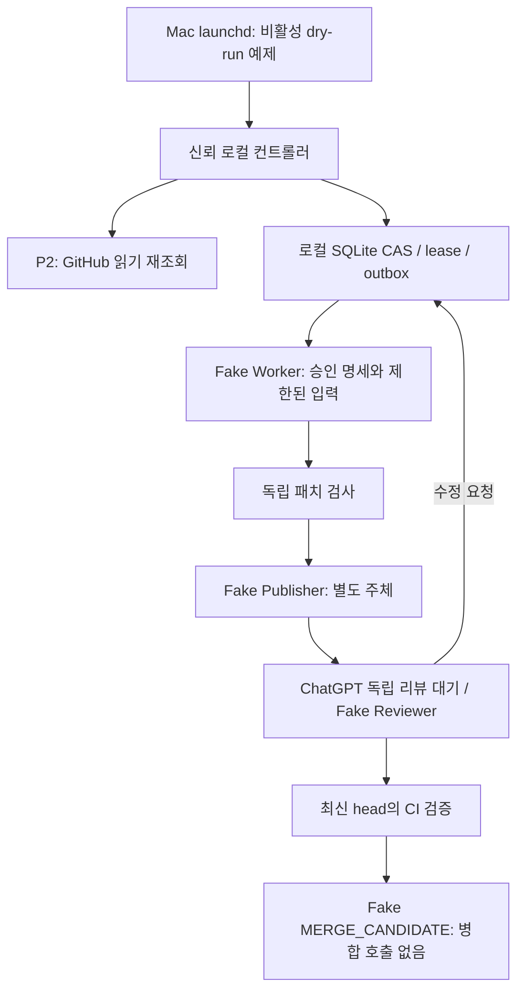

# P3: 추가 지출 0원 로컬 Worker·게시 브로커

## 현재 상태와 변경 이유

2026-10-21 사용자의 최우선 조건에 따라 **기존 ChatGPT Plus 구독료 외 추가 지출 허용액은 0원**입니다. MacBook M3/Python 3.12/로컬 SQLite/launchd를 단일 조정자로 삼는 설계입니다. 유료 Codex Action, API 과금, 유료 서버·DB·호스팅, 유료 runner, 크레딧 구매/한도 확대는 대체 경로가 아닙니다. 과거 P1/P2 문서의 API/외부 원장 제안보다 이 규칙이 우선합니다.

이번 구현은 Fake/Dry-run입니다. `enabled=false`, `REAL_TRADING=False`, P1 Fake-only 오케스트레이터와 P2 관측 전용 Snapshot 제약을 유지합니다. 모델·Codex CLI·실제 GitHub writer·merge·launchctl·로그인·배포는 호출하지 않습니다. 이 개발 PR을 제출하는 수동 개발 도구와 Fake Publisher의 게시 시뮬레이션은 별개입니다.

## 공식 경로 조사와 확인 한계

- [가격/포함 범위](https://learn.chatgpt.com/docs/pricing): Plus에 Codex CLI가 포함되고 구독 사용량이 적용됩니다. 추가 크레딧을 통해 사용량을 늘리는 기능도 있어 **Plus 로그인만으로 무료 무제한 또는 추가 결제 불가능을 보증할 수 없습니다**. 정해진 작업 수를 포함량으로 환산하지 않습니다.
- [공식 인증](https://learn.chatgpt.com/docs/auth): ChatGPT 로그인은 구독 접근, API 키는 별도 Platform 종량제 경로입니다. 사용자가 Mac에서 직접 `codex login`의 브라우저 흐름을 완료하고 `codex login status`로 인증 방식을 확인해야 합니다. 본 PR은 이 명령도 실행하지 않았습니다. auth.json/Keychain/브라우저 토큰을 추출·복사·공유·GitHub Secrets로 이전하지 않습니다.
- [공식 비대화형 실행](https://learn.chatgpt.com/docs/non-interactive-mode), [CLI reference](https://learn.chatgpt.com/docs/cli/reference): `codex exec`는 저장된 공식 로그인 세션을 사용하는 스크립트 경로이며 stdin/JSON 출력을 지원합니다. 미래에는 승인된 SHA의 별도 작업 디렉터리에서 이 경로를 사용할 수 있습니다. CLI pin/공식 auth 모드/권한 제한/구독 잔량/추가 크레딧 차단을 검증하기 전에는 호출하지 않습니다.
- `ops/local/codex-subscription.toml.example`은 비활성 참고 파일입니다. `forced_login_method="chatgpt"`로 인증 경로를 제한하는 공식 설정을 참고합니다. 이것만으로 사용량/크레딧/파일시스템 격리가 증명되지 않습니다. 실제 사용자 설정 파일은 변경하지 않았습니다.
- [ChatGPT 예약/이벤트 작업](https://learn.chatgpt.com/docs/automations): 지원 계정의 웹/모바일에는 GitHub PR 활동 트리거가 있습니다. 계정·워크스페이스별 가용성, GitHub 연결, 표준 Review 게시 권한은 사용자가 확인해야 합니다. Codex CLI가 ChatGPT Scheduled 관리 인터페이스를 제공하지는 않습니다. 실제 Plus 계정에서 자동 리뷰 가능 여부는 미검증입니다.

Plus의 구독 포함 한도 확인 경로와 추가 크레딧 잔액/자동 구매 설정을 사용자가 직접 확인해야 합니다. 공식 UI `/status`/사용량 dashboard의 존재가 unattended 실시간 quota/billing API 제공을 보장하지 않습니다. machine-readable 증빙·유효기간·크레딧 완전 차단을 증명하는 실제 어댑터는 구현하지 않았습니다. 인증 만료/한도 소진/증빙 불명/일시 unavailable이면 **중단**하며 API 키나 다른 모델·계정·플랜으로 자동 fallback하지 않습니다. 구독 한도 도달 시 현재 turn이 계속될 수 있다는 공식 설명도 있어, 요청 전 점검만으로 엄밀한 순간 차단을 주장하지 않습니다. 보증 불가이면 계속 비활성입니다.

## 로컬 아키텍처와 신뢰 경계



| 주체 | 입력/권한 | 현재 구현과 실제 활성화 전제 |
|---|---|---|
| Controller | 승인 metadata/명세 hash/version, P2 읽기 | FakeAuthority만 실행 권한으로 사용. P2 실제 Snapshot은 실행 입력으로 변환 금지 |
| Worker | 승인 명세, 승인 base/현재 revision SHA, 검증된 리뷰 데이터 | FakeWorker만 허용; GitHub 쓰기/Secrets/주변 환경변수/네트워크/host FS 능력 없음 |
| Patch guard | Worker 제출 bytes + trusted base tree + 고정 정책 | 모델의 valid/test-passed 플래그를 신뢰하지 않음 |
| Publish broker | 원장의 승인/version/lease/fence + 독립 재검사한 패치 | FakePublisher만; 실제 자격·GitHub writer 없음 |
| Reviewer | PR diff/정확한 head/CI | FakeIndependentReviewer; 실제 ChatGPT 리뷰 계정은 별도 GitHub 불변 ID가 필요 |
| Final gate | 최신 승인/리뷰/head/base/CI/threads | P4 범위. P3는 로컬 후보만 기록하고 merge 함수가 없음 |

생산 환경도 같은 Mac에서 Worker OS 계정/파일 권한/모델 도구 sandbox와 게시·검증 주체를 나눠야 합니다. CLI 자신의 공식 로그인 저장소는 사용하되 모델 도구가 auth/GitHub 자격/Keychain/SSH/운영 봇 파일을 읽지 못하도록 검증해야 합니다. 인증 파일을 임시 HOME으로 복사하는 편법은 금지입니다. 실제 macOS 격리와 자격 경계는 구현/검증 전이며 **Fake의 capability 제한은 OS sandbox가 아닙니다**. subprocess/네트워크/실제 checkout도 하지 않는 Fake이므로 실제 명령 취소·자식 프로세스 종료/디스크 제한을 검증한 것으로 보고하지 않습니다.

## Worker 계약

`worker_contracts.py`에 Worker/Publisher/UsageMeter protocol과 metadata 계약을 정의합니다. WorkInput은 작업 UUID/Issue/시도/명세 버전/hash/승인 base/정확한 checkout을 결합합니다. 최초는 승인 base, revision은 그 base에서 이어진 최신 Fake PR head에서 시작합니다. 브로커는 현재 remote parent/base와 lineage를 다시 확인합니다. SHA는 모의 commit identity이며 실제 Git commit 객체 검증이 아닙니다.

명세는 승인된 body 원문 한 개로 제한하고 리뷰는 별도 `untrusted_feedback` 구조화 데이터로 전달합니다. 셸/스크립트/template로 실행하지 않습니다. 프롬프트 문자열 필터만으로 주입을 해결했다고 주장하지 않습니다. 네트워크/파일/자격 capability 부재와 독립 출력 검사가 경계입니다. 실제 CLI에서는 trusted instructions/설정/MCP/hooks를 봉인하고 저장소의 임의 설정을 신뢰하지 않아야 합니다.

Fake 계약은 회당 supervisor 모의 호출 1회, 120초 미만, 출력 128KiB 이하, 환경변수 없음, 네트워크 없음, ephemeral task 영역만 쓰기를 허용합니다. 이 시간/호출 관측값은 Fake fixture입니다. 실제 Worker 자기 보고를 신뢰하는 계측기로 사용할 수 없습니다. 오류는 고정 reason으로 실패/감사 기록하며 원문 exception/출력을 로그에 남기지 않습니다.

## 패치 게시 검사

`patch_guard.py`는 unified diff를 셸로 적용하거나 Worker 디렉터리를 따라가지 않고 typed byte 변경만 검사합니다. task/spec/version/승인 base/parent/head 결합과 blob preimage를 확인하고 broker가 동일 검사를 다시 수행합니다.

- 현재 정책의 허용 prefix/protected prefix, 최대 20파일, 파일당 64KiB, 전체 128KiB, 변경 400줄/파일 1,000줄 이하
- 절대 경로/../역슬래시/ADS/percent 인코딩/숨김 segment/Unicode 제어 문자/Windows 예약명/대소문자 충돌/파일-디렉터리 충돌 거부
- 일반 파일 mode 100644 및 write만 수락. symlink/submodule/executable/binary/delete/rename 거부
- 명시적 credential 패턴/민감 할당/고엔트로피 불투명 문자열 검사 및 skip-ci/skip/pytest/unittest/security gate 우회 지시 거부
- **초기 프로필은 의도적으로 더 좁습니다:** tests 수정·추가, conftest/dunder import hook을 전부 거부합니다. 신뢰 테스트 oracle은 Worker가 바꾸지 못합니다. 자동 허용은 Markdown과 imports/calls/attributes/decorators 없는 제한된 pure-function Python AST뿐입니다. 일반 Python/테스트 개발은 P4의 별도 독립 검증 계약 전까지 자동 게시할 수 없습니다.

이 스캐너는 포괄적인 DLP/코드 의미 검증/악성코드 증명이 아닙니다. 인코딩된 비밀/문서 기반 사회공학/허용된 순수 함수의 논리 오류까지 완전히 판별하지 못합니다. 실제 자격이 Worker에 없고 독립 ChatGPT 리뷰/CI/P4가 반드시 필요한 이유입니다. 코드/테스트를 실행해 통과했다고 주장하는 것도 하지 않습니다. 실제 CI는 별도 비밀 없는 job에서 수행해야 합니다.

## 원장, 재시도, 장애 및 조정

P1을 우회하지 않도록 P3는 다른 application ID의 FAKE_ONLY task store를 사용합니다. P1 코드는 변경하지 않습니다. `SQLiteTaskStore`는 단일 Mac 로컬 파일에서 BEGIN IMMEDIATE/FULL/무결성·checksum/정책 binding/CAS로 예약·task·outbox·audit를 원자적으로 갱신합니다. 다른 호스트/NFS/GitHub runner 공유 용도가 아닙니다. `CoordinationStore`와 `FakeSharedStore`는 여러 runner client가 단일 서비스 CAS를 사용해야 한다는 계약/실패 시험용입니다. 실제 공유 DB나 호스팅은 만들지 않았고 새 로컬 운영 방식에는 필요하지 않습니다. callback은 trusted controller 내부 로직이며 네트워크로 임의 Python 코드를 전송하는 RPC가 아닙니다.

예약 정책은 회당 $5, Issue $15, UTC 일일 $50, 총 3회, 연속 실패 2회입니다. **이는 P1과 정합성을 맞춘 모의 admission counter이며 실제 지출 허용액은 0원**입니다. 실패/취소/만료/명세 변경으로 환급하지 않습니다. 날짜 변경도 이슈 누계를 초기화하지 않습니다. quota/인증/0원 증빙 확인은 별도 gate이며 reservation을 유료 실행 허가로 쓰지 않습니다.

작업 UUID/owner/version CAS, 영속 dispatched marker, lease 최대 300초/heartbeat 포함 절대 수명 1,200초를 적용합니다. 중복 실행/피드백/게시를 막고 새 head마다 이전 리뷰/CI를 초기화합니다. reviewer 2002/builder 1001/broker 3003은 **Fake namespace의 fixture**이며 실제 GitHub 신원 설정을 채우지 않습니다. 승인/리뷰가 바뀌거나 취소되면 중단하고 임의 feedback 셸 명령을 실행하지 않습니다. CI 실패·중복·old run/head 및 검증 누락도 후보를 통과시키지 않습니다.

| 상황 | 처리 |
|---|---|
| dispatch 전/후 중복 | 같은 task를 재실행하지 않음 |
| Mac 잠자기/중단 후 lease 만료 | UNKNOWN/HALTED; 자동 탈취·재시도 없음 |
| Worker 또는 patch 오류 | 실패 기록, 예약 유지, 2연속 실패 중단 |
| 게시 준비 | outbox PUBLISHING을 먼저 영속화한 뒤 Fake effect |
| 게시 성공 후 응답 유실 | UNKNOWN/HALTED, read-only receipt 대조; push/PR 재전송 금지 |
| receipt 확인/불명 | 확인되더라도 HALTED 유지; 불명도 재게시하지 않음 |
| 승인/feedback/head 변경 | 기존 task·패치·리뷰 재사용 금지 |
| DB 손상/유실/clock 역행/정책 변경 | fail-closed; 새 DB 생성이나 예산 reset으로 회피 금지 |

FakePublisher는 atomic in-memory branch CAS/PR/receipt를 모의합니다. 실제 GitHub의 push와 PR 생성은 단일 트랜잭션이 아니며 부분 성공/타임아웃/서버 fencing을 별도 구현해야 합니다. FakeAuthority lock도 로컬 simulation 경합 제어일 뿐 GitHub 승인 변경과 publish 사이의 분산 트랜잭션을 보증하지 않습니다. 그러므로 실제 게시가 활성화되지 않습니다.

`FakeWitness`는 별도 epoch/revision/hash high-water mark를 기억하여 DB rollback/유실/commit 이후 witness 갱신 전 중단을 탐지하는 **시험용**입니다. 실제 OS 프로세스가 모두 종료되면 이 메모리는 사라집니다. SQLite 상태는 남지만, 실행 재개에는 독립 checkpoint가 필요하므로 없으면 중단합니다. 같은 witness를 가진 client 재시작은 테스트했고 실제 자식 os._exit 후에는 mismatch로 차단됨을 검증합니다. 진짜 Mac Keychain 등에 비용 없이 보관하는 checkpoint/사용자 대조 절차는 아직 구현하지 않았습니다. 단순 DB 옆 sidecar까지 함께 롤백할 수 있는 상황에서 완전한 anti-rollback을 주장하지 않습니다. 정상 부팅 후에도 증빙 없이는 자동 작업 재개가 아닌 **안전한 보류**입니다.

## 실행과 launchd

외부 호출 없는 명령만 제공합니다. runtime 디렉터리는 사용자가 먼저 만들고 demo는 각기 **새** DB 파일을 사용합니다.

```bash
python -m automation.local_runner --dry-run
python -m automation.local_runner --dry-run --database runtime/p3-normal.sqlite3 --scenario normal
python -m automation.local_runner --dry-run --database runtime/p3-revision.sqlite3 --scenario revision
python -m unittest discover -v
```

기본 tick은 DISABLED/0원/0 model calls만 출력합니다. demo는 실제 SQLite에 Fake 흐름을 기록하고 정상 1회/수정 2회 후 MERGE_CANDIDATE에서 멈춥니다. 같은 DB 덮어쓰기는 거부합니다. 자동 tick은 새 원장을 만들거나 로그인·CLI 실행을 하지 않습니다.

`ops/local/com.auto-trade.dry-run.plist.example`은 Disabled=true/RunAtLoad=false/KeepAlive=false와 절대 경로 placeholder를 가진 LaunchAgent 예제입니다. 등록·복사·launchctl 호출을 하지 않았습니다. 로그인 세션의 launchd가 Mac이 깨어 있을 때만 주기적으로 trusted checkout의 **dry-run만** 호출하는 구조이며, 잠자기/전원 종료 중 정시/연속 실행을 보장하지 않습니다. 미실행 tick을 작업 실행으로 계산하거나 깨어난 뒤 무조건 catch-up하지 않습니다. wake 후 API/lease/checkpoint부터 대조해야 합니다. M3 실제 launchd/OS sandbox/Keychain/CLI auth 시험은 미수행입니다.

## 독립 ChatGPT 리뷰와 P4 계약

기존 별도 ChatGPT가 GitHub 표준 리뷰를 게시하는 방식을 유지합니다. 사용자가 자신의 Plus 웹/모바일에서 지원되는 GitHub 이벤트 또는 예약 Work 작업, 저장소 연결, 별도 리뷰 identity, 표준 review의 정확한 commit_id를 실제로 확인해야 합니다. Codex GitHub 자동 리뷰를 독립 ChatGPT로 바꿔 부르지 않습니다. 계정/기능이 없거나 리뷰가 오지 않으면 WAIT_REVIEW를 유지하고 모델/API/비공식 ChatGPT 세션 호출로 대체하지 않습니다. 이 PR은 예약 작업도 생성하지 않았습니다.

P2 `p2_feedback_candidates()`는 재인증이 필요한 데이터 계약일 뿐 실행 승인 토큰이 아닙니다. 실제 adapter/broker는 최신 repo/Issue/spec/version/head/actor/review/CI를 다시 확인해야 합니다. P2 `current()`는 직접 target/resource와 API로 확인된 workflow-run alias만 보류 판정에 사용하도록 고쳤습니다. 무관한 Issue/PR/run의 신규 pending·실패는 다른 대상을 막지 않고, 동일 대상/알려진 run alias의 오류는 계속 fail-closed입니다. 알려지지 않은 run의 PR 관계를 webhook으로 추정하지 않습니다. 캐시는 여전히 historical/requery-required입니다.

P4는 리뷰 수신 재인증/철회/누락 복구, review threads/CODEOWNERS/rulesets, exact head/base/CI run-check/자격 분리, partial publication receipt 및 최종 CAS gate를 구현해야 합니다. merge 명령은 없으며 로컬 후보는 병합 허가가 아닙니다. P4 검증 후에도 사용자 별도 승인과 0원 증명 없이 Worker/게시/병합을 켤 수 없습니다.

## 비용 0원으로 구현한 것과 사용자 확인 사항

| 추가 서비스 구매 없이 구현·시험 | 실제 Plus/Mac 계정에서 확인/추가 구현 필요 |
|---|---|
| 로컬 Python/SQLite Fake task·lease·audit·outbox | 공식 CLI pin, Mac M3 OS 격리, auth/Keychain 접근 경계 |
| Fake Worker/Publisher/Reviewer, 제한된 patch 검사 | ChatGPT Plus 공식 로그인·유효한 포함 사용량·추가 크레딧 미사용 증빙 |
| 로컬 CLI 및 비활성 launchd 예제 | 사용자만 LaunchAgent 검토/경로 설정, 실제 등록은 별도 승인 후 |
| 기존 P1/P2와 분리된 관측·실행 계약 | P2 live 읽기 권한/보호 규칙, 별도 builder/reviewer ID, broker 범위 |
| public 저장소의 standard Linux/macOS/Windows CI | 저장소 공개 유지/유료 runner·스토리지 사용 금지, GitHub 계정 과금 설정 확인 |

[GitHub 공식 과금 문서](https://docs.github.com/en/billing/concepts/product-billing/github-actions)는 public repository의 standard runner 사용을 무료로 설명합니다. 현재 repo id 888367411은 공개 저장소로 API 확인했습니다. 기존 3개 standard runner는 유지하고 cache 업로드 설정을 제거했으며 artifact/storage 업로드를 추가하지 않았습니다. larger runner/유료 runner는 금지입니다. 저장소를 private으로 바꾸거나 CI/스토리지 조건이 달라지면 무료를 추정하지 말고 중단·재검토해야 합니다. 계정의 기존 청구액 전체를 이 코드가 0원으로 보증하지는 않습니다.

사용자만 공식 로그인/계정 가용성/크레딧 미사용/무료 GitHub 조건을 확인합니다. API 키 발급·등록은 **필요 사항이 아니라 금지 사항**입니다. DB/서버/유료 호스팅 구매도 필요 없습니다. 실제 GitHub 게시 권한은 P4 후 최소 범위의 별도 주체로 사용자가 검토하며 이번에는 변경하지 않습니다. 현재 추가 비용이 발생하지 않는 이유는 모든 Worker/게시/리뷰가 Fake이며, 실제 외부 모델/게시 경로 자체가 없기 때문입니다.

검증 로그/정확한 테스트 수와 3개 OS CI 결과는 해당 PR에 기록합니다. 이 PR의 fake 테스트는 실제 구독 비용/자격/운영 배포 E2E를 대신하지 않습니다.
