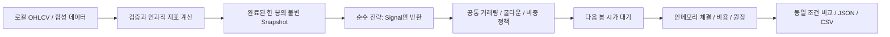

# 지표 합의형 전략 연구와 오프라인 백테스트 설계

## 목적과 승인 경계

PR #1은 master `d75bd27af9e49b62cdd76527f78823cc0d150bec`에 병합됐습니다.
이번 단계는 사용자가 요청한 **비교 가능한 연구 기반**을 구현합니다. 수익성 있는 최종 전략의 선정이나
실거래 전환이 아닙니다. ChatGPT가 아키텍처·후보 전략·검증 방법을 리뷰하고 병합을 판단합니다.
실제 업비트 주문·인증 계좌 조회·맥북 운영 배포는 계속 금지합니다. `REAL_TRADING=False`를 유지합니다.

## 아키텍처와 변경 이유



- `strategies/signals.py`: 전략은 현재 완료된 관측치만 읽고 BUY/SELL/HOLD·이유·표를 반환합니다.
  계좌, 주문, 네트워크, 저장소 또는 비용을 알지 못합니다. 전략 간 상태를 공유하지 않습니다.
- `data_analyzer/analyzer.py`: 기존 봇의 API 조회·지표/쿨다운 관리는 유지하고 기존 결정을
  `LegacyCompositeStrategy`로 위임합니다. 새 연구 전략으로 기본값을 바꾸지 않습니다.
- `trading/auto_trade.py`, `trading/execution.py`, `trading/state_store.py`, JWT 브로커는 수정하지 않습니다.
  기존 영속화·중복 방지·체결/복구 계층은 유지합니다.
- `backtesting/data.py`: 엄격한 OHLCV 입력과 별도 인과적 지표 파이프라인.
- `backtesting/engine.py`: 동일 설정의 신호 정책·다음 시가 체결·명시적 비용·원장·성과 산출.
- `backtesting/__main__.py`: 오프라인 입력/출력만 제공하며 live 옵션이나 실제 브로커 주입 경로가 없습니다.

분리 이유는 전략을 주문 부작용 없이 검증하고, 같은 전략 계약을 여러 체결 환경에서 사용할 수 있게 하기 위해서입니다.
백테스트는 실제 영속 주문 엔진을 호출하지 않습니다. 과거 신호가 실제 API에 전달되거나 운영 상태를 오염시키는 것을
구조적으로 피하기 위해 인메모리 시뮬레이터를 따로 둡니다. 공통 계약은 Snapshot → Signal입니다.

예상 영향: 기존 봇의 현재 봉 신호/우선순위/목표가 메타데이터는 회귀 검사로 유지합니다.
연구 엔진은 아래의 시간·비용·워밍업 가정이 다르므로 기존 봇 성과의 정확한 재현이라고 주장하지 않습니다.

## 비교할 연구 가설

| 이름 | BUY | SELL |
|---|---|---|
| `rsi` | RSI < 30 이고 전 봉보다 증가 | RSI > 70 이고 전 봉보다 감소 |
| `macd` | MACD > Signal, MACD < 0, 전 봉보다 증가 | MACD < Signal, MACD > 0, 전 봉보다 감소 |
| `bollinger` | 종가 < 하단 밴드 | 종가 > 상단 밴드 |
| `consensus_2of3` | 같은 봉에서 위 세 단독 지표 중 BUY가 2개 이상 | SELL이 2개 이상 |
| `consensus_3of3` | 세 지표 모두 BUY | 세 지표 모두 SELL |

- MACD는 기존 코드의 **수준+방향** 조건을 연구 기준으로 가져옵니다. 새 교차 이벤트 감지로 바꾸지 않습니다.
- 단독 BB는 RSI/MACD의 반등 확인을 사용하지 않는 **연구용 가설**입니다. 기존 봇의 BB 조건과 다릅니다.
- 2/3 합의는 단순 다수결입니다. 반대 1표가 있어도 2표가 충족되면 신호를 냅니다. 3/3은 만장일치입니다.
  HOLD는 기권입니다. 표별 정보도 보고서에 남깁니다. 가중치·추세 필터·새 파라미터 최적화는 없습니다.
- 전략의 `target_price`는 비교에서도 메타데이터입니다. 전략마다 다른 목표가 청산을 몰래 적용하지 않습니다.
- 선택 가능한 `legacy_composite`는 기존 BB 반등 확인·RSI→MACD→BB 순서 덮어쓰기·복합 신호 우선순위를 유지합니다.
  이 옵션도 연구 엔진의 동일 비용·워밍업·신호 전용 체결을 사용하므로 운영 봇 재현 실험은 아닙니다.

이 후보들은 ChatGPT 검토를 위한 명시적 가설입니다. 비교 결과로 운영 전략을 자동 선택하지 않습니다.

## 데이터 계약과 미래 정보 방지

CSV 열: `timestamp,open,high,low,close,volume`. timestamp는 시간대가 있는 **봉 시작 시각**입니다.
입력은 UTC로 정규화하며 순서·중복·결측·비정상 가격·음수 거래량·OHLC 범위를 검사합니다.
지정된 `bar_seconds` 간격에서 빠진 봉은 오류입니다. 자동 정렬·재표본화·전방 채움으로 의미를 바꾸지 않습니다.
상장폐지·종목 선정 편향과 데이터 출처 검증은 별도 연구에서 관리해야 합니다.

- RSI: 기존 단순 rolling 14 방식. 이익/손실이 모두 0이면 워밍업 후 50으로 정의합니다.
- MACD: EWM 12/26, signal EWM 9, `adjust=False`, 각각 충분한 관측치 이후 유효.
- 볼린저: rolling 20 평균과 표본 표준편차의 ±2배.
- 거래량 평균: 20봉. 모든 후보에 같은 50% 최소 거래량 비율을 사용하며 완료된 0거래량 봉은 신호를 만들지 않습니다.
- **bfill/ffill을 쓰지 않습니다.** 초기 결측은 그대로 두고 모든 지표와 전 봉 값이 유효한 공통 시점부터 비교합니다.
  기본 계산은 인덱스 34(35번째 봉)에서 최초 신호 가능, 최소 36개 봉이 있어야 다음 시가 체결까지 검증할 수 있습니다.
- 전체 데이터의 과거 구간 계산과 해당 시점까지 잘라 계산한 결과가 같은지 prefix invariance를 테스트합니다.
- 기존 봇의 bfill/ffill과 `analyze(index)`의 최신 delta 호환 동작은 이번에 바꾸지 않습니다.
  연구 엔진은 이 과거 index API를 사용하지 않고 해당 시점의 Snapshot만 전달합니다.

## 공통 체결·비용·자금 조건

1. 봉 t가 끝난 후 종가와 그때까지의 지표로 신호를 만듭니다.
2. 주문 가능한 신호는 **다음 봉 t+1의 시가**에만 체결합니다. 같은 봉의 종가 체결은 하지 않습니다.
   신호 봉 시작, 결정 시각(t의 끝), 체결 시각(t+1의 시작)을 원장에 함께 남깁니다.
   연속 봉에서는 결정 시각과 다음 봉 시작 시각이 같은 벽시계 시각일 수 있습니다.
3. 비용 입력은 bps(1bp=0.01%). CLI는 편도 수수료와 슬리피지를 필수로 받습니다.
   예시 `fee=5, slippage=3, spread=2`는 가상의 연구 가정이며 현재 업비트 요율을 뜻하지 않습니다.
4. 매수 가격 = 다음 시가 × (1 + 슬리피지 + 전체 스프레드/2).
   매도 가격 = 다음 시가 × (1 - 슬리피지 - 전체 스프레드/2).
   수수료는 양쪽 체결대금에 각각 부과합니다.
5. 매수 예산은 min(초기자금×공통 비중, 현재 현금), **수수료 포함**입니다. 기본 비중 40%,
   수량은 연구 가정 1e-8 단위로 내림합니다. 기본 최소 체결대금 5,000원, 매도는 보유량 전부입니다.
6. 한 실험은 **단일 자산·현물·롱 전용·한 포지션**입니다. 중복 BUY·미보유 SELL은 체결하지 않고
   차입/공매도/추가 매수는 없습니다. 다종목 포트폴리오 엔진은 후속 범위입니다.
7. 쿨다운은 봉 시각 기준 기본 300초이며, 거래량 필터와 함께 모든 후보에 똑같이 적용합니다.
   기존 정책처럼 실행할 수 없는 BUY/SELL 신호도 쿨다운을 소모합니다.
8. 연구 기본값은 **신호만의 비교**입니다. 손절·익절·물타기 오버레이를 적용하지 않습니다.
   이는 기존 봇 정책의 제거/교체가 아니라 지표 차이를 분리해 보기 위한 공통 실험 조건입니다.
9. 마지막 봉 신호는 다음 봉이 없으므로 체결하지 않고 미체결 메타데이터로 기록합니다.
   마지막 보유분은 종가로 평가하며 강제 매도와 가상의 청산 비용을 넣지 않습니다.

즉시 전량 체결·고정 비용 가정입니다. 주문장 깊이, 부분 체결, 체결 지연, 시가 유동성, 시장 충격,
거래소 최소금액/수량 정책의 실제 유효성은 검증하지 않습니다. 다음 봉의 완료 거래량을 보고 과거 시가 체결을
취소하는 식의 미래 정보 이용도 하지 않습니다.

## 원장과 비교 결과

- Decimal로 현금·체결대금·양쪽 수수료·매수 원가·실현손익을 계산합니다.
- `final_equity = cash + quantity × final_close`, `net_pnl = final_equity - initial_cash`.
- 실현손익은 매수/매도 양쪽 수수료를 포함합니다. 열린 포지션의 미실현손익에는 이미 낸 매수 비용만 포함하며
  아직 발생하지 않은 청산 비용은 포함하지 않습니다. 실현+미실현과 총손익의 일치를 검사합니다.
- 최대 낙폭은 초기 현금을 첫 고점 기준에 포함한 종가 평가금액 곡선으로 계산합니다.
- 승률은 완료된 왕복 거래만 대상으로 합니다. 완료 거래가 없으면 null이며 무한대/NaN 성과 지표를 만들지 않습니다.
- 보고서에는 정규화 OHLCV SHA256(시각 정밀도 포함), 공통 설정·가정, Python/pandas/NumPy 버전,
  각 전략의 표·신호·체결 원장·현금/보유량/평가금액 곡선과 비용을 남깁니다.
- 출력: `report.json`, `metrics.csv`, 전략별 `*-fills.csv`, `*-signals.csv`, `*-equity.csv`.
  빈 신호/체결 목록은 JSON의 빈 배열로 남으며 해당 빈 CSV는 생략합니다. 기존 출력 경로는 덮어쓰지 않습니다.

## 실행과 검증

```bash
python -m backtesting --demo --fee-bps 5 --slippage-bps 3 --spread-bps 2 --output runtime/research-demo
python -m backtesting --csv candles.csv --bar-seconds 60 --fee-bps 5 --slippage-bps 3 --spread-bps 2 --output runtime/research-csv
python -m backtesting --demo --fee-bps 5 --slippage-bps 3 --strategies rsi legacy_composite --output runtime/research-legacy
python -m unittest discover -v
```

`--demo`는 고정 수식으로 만든 **합성** OHLCV입니다. CLI/회계/재현성 검사용이며 시장 수익성의 증거가 아닙니다.
이번 작업에서는 실제 시장 데이터 성과 비교나 승자 선정, 하이퍼파라미터 최적화를 수행하지 않습니다.
연구용 패키지 import 시 config/API/실거래 엔진이 로드되지 않는지 별도 프로세스에서 검사합니다.

## ChatGPT 리뷰 및 후속 연구

- 단독 BB 정의, 2/3 반대표 처리, MACD 수준 조건이 원하는 연구 가설인지 검토합니다.
- 신호 전용 비교 후 같은 데이터/비용에서 공통 위험 오버레이를 비교할지 결정합니다.
- 실제 출처가 명확한 데이터·종목 선정 기준·학습/검증/미관측 기간 분리·워크포워드·비용 민감도를 정합니다.
- [물타기 #2](https://github.com/sasumpi123/auto_trade/issues/2), [40% 비중 #3](https://github.com/sasumpi123/auto_trade/issues/3),
  [bfill #4](https://github.com/sasumpi123/auto_trade/issues/4), [비용 #5](https://github.com/sasumpi123/auto_trade/issues/5)는
  이 기반 위에서 연구할 항목이며 이번 PR로 자동 종료하거나 운영 정책을 확정하지 않습니다.
- 비용 모델의 현실성, 체결 제한과 다종목 자금 경합, 큰 데이터의 성능·스트리밍, 전체 의존성 고정은 추가 검증이 필요합니다.
- PR 병합은 전략의 실거래 승인이나 맥북 운영 배포 승인을 뜻하지 않습니다.
